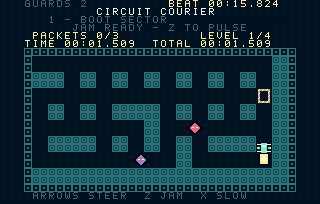

# Chipbuilder

A handheld console project inspired by an alternate-history Atari Lynx successor
from roughly 1993–1995. The aim is to design the boards, graphics/audio hardware,
firmware, and games, using specialized hardware with deliberate limits.

New games target **320 × 204** native rendering. Legacy Lynx games retain
**160 × 102** rendering and receive exact 2× visual scaling. A color display with
a **backlight** is required; the exact panel remains under investigation.

For the HTML review area, run `nix run .#docs` and open
<http://127.0.0.1:8787>. It covers the current target, architecture, decision
history, open tradeoffs, work plan and evidence. The
[documentation workflow](docs/documentation.md) explains building and updating it.

This repository contains the development environment, research, architecture
records, a CPU-driven software prototype with an original game, and a separate
display/controller/audio bring-up core built for MiSTer. It contains no PCB or
physically verified Lynx compatibility core. The separate Lynx feasibility audit
passes its software and core-only resource/timing gates; board integration is in progress.
See the [prototype build and hardware instructions](hardware/README.md).
Simulation and Quartus compilation pass. Physical testing is deferred at the
owner's request; development proceeds using software simulation under
[ADR 0004](docs/architecture/decisions/0004-software-first-validation.md). The
[acceptance record](docs/milestones/first-mister-prototype.md) contains the RBF
hash, timing results, and remaining checks.
Existing MiSTer hardware remains available for bring-up. The current standalone
prototype target is **Tang Nano 20K with the Lynx CPU inside the FPGA** under
[ADR 0009](docs/architecture/decisions/0009-tang-prototype.md); see the
[current integration architecture](docs/architecture/tang-prototype.md).
The [earlier ECP5 contract](docs/architecture/standalone-platform.md) remains
historical reference. Neither the complete Tang board port nor enhanced graphics
fit has been demonstrated. Physical CPUs and manufactured custom chips remain
possible later destinations.

## Play the software prototype

```sh
nix --extra-experimental-features 'nix-command flakes' run .#sim
```

Circuit Courier runs an original 65C02 ROM against custom tile/sprite, audio,
and input hardware in simulation. Use arrows/WASD to move, Z/Space or Enter to
connect/retry, X for slow movement, P to pause, R to reset, and Escape to quit.
Hold a direction to move along maze lanes; release it to stop immediately.
Collect three packets and reach the dock. Turns buffer at
intersections, walls block shortcuts, and you can reverse inside a corridor.
Press Z/Space while JAM READY to freeze guards and pass through them for one second.
Circuits increase from two guards to five, with different roles and fewer shortcuts.
Complete four circuits and race for the lowest total time. The HUD shows current
and total times as `MM:SS.mmm`; press Z/Space/Enter after delivery for the next circuit.
Every attempt randomizes the route. Finish before the **BEAT** time to qualify;
later circuits demand a faster pace and take longer to recharge your jam pulse.



See the [simulator workflow](sim/README.md),
[prototype architecture](docs/architecture/software-prototype.md), and
[milestone evidence](docs/milestones/playable-software-prototype.md).

## Development

On x86_64 Linux with Nix installed:

```sh
nix --extra-experimental-features 'nix-command flakes' develop
nix --extra-experimental-features 'nix-command flakes' flake check -L
nix --extra-experimental-features 'nix-command flakes' fmt
```

For the full simulated controller traversal and a generated pixel preview:

```sh
nix --extra-experimental-features 'nix-command flakes' build .#simulation-full -o build/prototype-simulation-full -L
```

This uses Verilator and needs no attached hardware or Quartus installation.

The default shell provides Verilator, Icarus Verilog, GHDL, Yosys, GTKWave, cc65,
SDL, Python, Make, Git, pkg-config, and native C/C++ tools. All come from the locked
Nixpkgs input. No Arch packages or user-profile installs are needed. Initial
downloads and Nix-store builds happen on entry; no custom installation commands
run in the shell hook. GTKWave needs a working host graphical session.

This is dependency isolation, not a restricted interactive filesystem/network
sandbox. Nix derivation checks run under the host Nix build-sandbox policy.
The shell uses the current project directory for `.cache/`; enter it from the
repository root. Keep outputs in `build/`. This does not hide your home directory
or make all tool configuration hermetic.

The fixtures under [checks/](checks/) exercise the toolchain rather than define
the console architecture. cc65 currently compiles a standalone 65C02 object; no
final console SDK has been chosen. The original prototype ROM has its own small
linker map and startup code. Yosys supplies
generic synthesis checks; Quartus remains responsible for MiSTer implementation.

For standalone ECP5 tools and a reproducible CPU/resource sizing report:

```sh
nix --extra-experimental-features 'nix-command flakes' develop .#ecp5
nix --extra-experimental-features 'nix-command flakes' build .#standalone-cpu-sizing -o build/standalone-cpu-sizing -L
```

The report checks the [platform budget](hardware/targets/standalone.json), maps
the CPU to ECP5 primitives and records its logic use. It does not establish the
complete console's resource fit, timing or physical pin assignments. No device
is programmed automatically.

For the original Lynx core's Tang Nano 20K feasibility investigation:

```sh
nix --extra-experimental-features 'nix-command flakes' develop .#tang
nix --extra-experimental-features 'nix-command flakes' build .#lynx-compatibility-audit -o build/lynx-compatibility-audit -L
nix --extra-experimental-features 'nix-command flakes' build .#lynx-audit-report -o build/lynx-audit-report -L
nix --extra-experimental-features 'nix-command flakes' build .#lynx-audit-smoke -o build/lynx-audit-smoke -L
nix --extra-experimental-features 'nix-command flakes' build .#lynx-audit-route-probe -o build/lynx-audit-route-probe -L
```

The [compatibility audit](docs/research/lynx-tang20k-compatibility.md) separates
the original console from board services. The new
[Tang service and console integration milestone](docs/milestones/tang-board-services.md)
covers the UART/CRC host loader, guarded image commit, SDRAM/controller tests,
cartridge cache, ordered RGB frames and warm-reset correction. Reproduce with:

```sh
nix --extra-experimental-features 'nix-command flakes' build .#tang-services-check .#lynx-link-check .#lynx-tang-core-check .#video-fifo-check .#frame-capture-check -L
nix --extra-experimental-features 'nix-command flakes' run .#lynx-link -- inspect path/to/owned-game.lnx
```

The [buffered-video milestone](docs/milestones/tang-video.md) adds the capture,
shared memory arbiter and dual-clock line buffers. Patterned console output now
passes exact 2× pixel comparisons on a centered 320×204 canvas. Reproduce with
`nix build .#video-pipeline-check .#lynx-tang-video-check .#tang-system-sizing`.
The [stereo audio milestone](docs/milestones/tang-audio.md) adds signed filtering,
coherent left/right transfer and pin-decoded I²S from actual Mikey-generated tones
while video runs. Use `nix build .#audio-output-check .#lynx-tang-av-check .#tang-av-sizing`.
These are software/mapping checks. Video serialization, analog audio, full board
timing, physical testing and enhanced-engine implementation remain ahead.

The route probe separates the pinned console from MiSTer's infrastructure, uses
registered test boundaries and retains failures as evidence; inspect its exit
code and timing report. It is not a playable Tang image or board acceptance.
The corrected baseline console passed the registered-core 64 MHz route test, using 56.5% of
logic sites and 33/46 block RAMs after routing, including the test harness.
The aggregate audit also checks the diagnostic and Intel RAM-model comparison.

## Quartus for MiSTer

Quartus is optional and separate from the default shell:

```sh
nix --extra-experimental-features 'nix-command flakes' develop .#quartus
bash scripts/check-quartus.sh
```

The pinned version is **Quartus Prime Lite 17.0.2.602 with Cyclone V support**.
The vendor archive is fetched with a compatible client header and its published
checksum is enforced. See [tooling research](docs/research/tooling.md) for the
legacy installer compatibility work and validation status. No other Quartus
version is silently substituted.

Unfree-package permission is limited to this Quartus package, its runtime, and
its vendor archive. The packaging invokes the vendor installers in unattended
mode. Review the vendor terms before building the archive. Default
checks neither fetch nor install Quartus. No check programs an FPGA.

## Project records

Start at the [documentation index](docs/README.md) and
[architecture overview](docs/architecture/overview.md).
Research findings are dated and sourced; accepted decisions are kept separately
from open questions. Update the lock file deliberately, then rerun checks:

```sh
nix --extra-experimental-features 'nix-command flakes' flake update
nix --extra-experimental-features 'nix-command flakes' flake check -L
```

External sources and vendor binaries retain their own licenses. The prototype
builds use no Atari boot ROM or commercial game ROM. The reused CPU and independent
CPU test fixtures retain their own notices; Circuit Courier is an original ROM.
