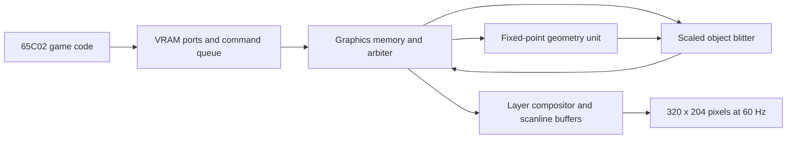

# Enhanced graphics effects hardware

Date: 2026-10-29. Status: earlier design exploration. Its platform/resource
choices are superseded by the [standalone contract](standalone-platform.md) and
[ADR 0008](decisions/0008-standalone-development-target.md), dated 2026-10-30.
The effects below supply design background; they are not implementation evidence.
The owner requested Lynx-style scaling, many parallax layers, dense sprites and
basic 3D. Capacities and clocks below are engineering targets for simulation;
they are not measured performance or a selected board/ASIC configuration.

Budget clarification, 2026-10-29: the owner targets around US$10 for the FPGA or
prototype board (scope pending clarification) and rejected the US$275 board
recommendation. The capacities below must be evaluated against that budget;
they do not establish an affordable device fit. See the
[standalone budget research](../research/fpga-and-custom-silicon.md).

## Design direction

Keep the 65C02 as the game orchestrator. Build three original fixed-function HDL
engines that move graphics work off its eight-bit bus. Initially these are modules
in one FPGA, sharing local graphics memory. Logical engine boundaries do not
require three separate IC packages. Decide physical partitioning after measuring
memory traffic, timing, FPGA resources, pin count and power.

Hardware partition clarification, 2026-10-30: the CPU may be a separate physical
65C02, with existing retro/standard ICs used where useful. The owner supports
evaluating this [hybrid hardware option](hybrid-hardware.md). The three graphics
engines remain original HDL; an all-in-one FPGA console is not a requirement.
Simulation continues to use the existing CPU model.



The existing eight-sprite machine remains the current implementation. This
proposal introduces an enhanced graphics mode; the current ROM must keep working
while it is developed. Neither that prototype mode nor the new engine establishes
Lynx compatibility. A future legacy mode must reproduce Suzy/Mikey-visible state,
decoding, arithmetic, collisions, timing and contention, then scale its 160×102
output exactly 2×. Reusing arithmetic or pixel machinery is possible only where
legacy tests prove equivalence.

For initial Lynx support, run unmodified game images and replicate each legacy
pixel into a 2×2 block. Decompilation/recompilation, native-resolution patches and
enhanced ports are deferred; they are not prerequisites for compatibility. New
native games use the enhanced engines. This scope follows the owner's
2026-10-29 clarification of [ADR 0003](decisions/0003-display-resolution.md).

## Scaled object blitter

Use framebuffer drawing, rather than extending the current parallel sprite loop
to hundreds of objects. A proposed table holds 256 persistent object descriptors.
A command list selects and orders their draws. The count describes the resident
table, not a guarantee that 256 large sprites can be redrawn each frame.

- Variable source dimensions, initially 1–256 pixels per axis, with clipping.
- Packed 4-bpp and 8-bpp source images, palette banking and transparent index zero.
- Independent X/Y nearest-neighbor zoom, flips and fractional position/scale.
- Per-row horizontal origin and scale increments for Lynx-inspired tilt/stretch.
- Destination clipping before writes, bounded commands, completion fences and IRQ.

Use incremental fixed-point source coordinates, so a pixel step is primarily
addition. Size-to-step conversion occurs at command setup, with a divider or
precomputed reciprocal. Specify rounding, zero scale, overflow, clipping and
shared edge behavior before RTL. Rotation can later reuse a two-coordinate affine
sampler; it is a separate extension to simple zoom/tilt.

Objects render into a back surface while the compositor reads the front surface.
Each proposed surface pixel occupies 16 bits: an eight-bit palette index, a
four-bit layer insertion band and four reserved bits. These are composition
metadata, not a depth buffer. A 320×204 surface occupies 130,560 bytes; two occupy
261,120 bytes. Surfaces clear to transparent each new frame.

The command list orders objects by insertion band, then back-to-front within each
band. Later nontransparent pixels overwrite earlier ones. This permits ordinary
writes without destination reads or per-pixel priority comparisons. The compositor
can then insert the visible object pixel between background planes. Arbitrary
unsorted draws would require a different rule and extra memory traffic.

There is no per-scanline sprite-count limit in this design. There is a total
render-time limit: overlapping or enlarged sprites still consume fill bandwidth,
and transparent source pixels still consume sampling/decoding work. A completed
back surface swaps at vblank. If late, retain the previous front surface and set
a sticky late-frame flag; never show an incomplete render. Tile/palette state must
be committed with the same fence so the displayed frame remains coherent.

## Layer compositor and raster effects

Target eight independent 4-bpp tile planes, with 8×8 tiles, 16 palette banks and
independent map/tile bases. A starting map size of 64×32 cells per plane costs
4 KiB per map, or 32 KiB for all eight. Tile patterns can be shared. Each plane
has its own X/Y scroll, wrapping, enable, priority and transparent index zero.

Read map entries and packed tile rows into small caches ahead of display. Merge
plane pixels and the object surface in a pipelined priority compositor. Double
scanline buffers and an arbiter with reserved display service prevent the drawing
engines from starving scanout. Preload the first visible line during vblank.

Add a bounded raster table for per-line horizontal scroll and palette-bank changes.
That enables water distortion, heat haze, split screens and road curvature without
an interrupt for each line. Shadow registers and explicit line/frame latching make
updates deterministic. A repeated deadline miss must produce a documented border
or repeat policy plus an underrun flag, rather than unpredictable memory reads.

Eight actual planes are distinct from eight apparent depth bands made with line
scroll. Both are useful. Affine sampling for a rotating/scaling floor is a later
extension, budgeted separately because it loses ordinary tile-row fetch locality.
Alpha blending and framebuffer read-modify-write effects are outside the first
version; transparency, palette effects and optional checkerboard patterns suffice.

## Basic 3D engine

Build this in two steps. First accept screen-space triangles and draw flat-color
spans through the blitter. Then add an autonomous indexed-mesh command that reads
vertices and indices from graphics memory, applies a matrix, projects, clips and
feeds triangles to that rasterizer. Hardware handles repetitive vertex/pixel work;
the CPU submits camera/object state and handles gameplay and scene organization.

The geometry step needs multiply-accumulate arithmetic, division or reciprocal
approximation, near-plane clipping, viewport clipping, backface culling and a
precisely specified triangle edge rule. Freeze fixed-point formats, accumulator
widths, rounding and overflow behavior using numerical tests before implementation.
Hardware near-plane clipping may create extra triangles and must have bounded
output buffering. Reject invalid inputs deterministically.

Start with wireframes, flat-shaded triangles and scaled billboard sprites. Use
painter ordering, supplied by game code for a constrained scene, with no depth
buffer. Sorting by object or average triangle depth is not generally correct for
intersecting/cyclic geometry; assets and scenes must respect that limitation.
Later evaluate affine textured triangles and subdivided polygons. Perspective-
correct texturing and a Z buffer would materially increase the design scope.

A useful initial demonstration is a low-poly vehicle/scene at a target 30 geometry
updates per second, over backgrounds scanned at 60 Hz. This is a benchmark to
establish, not a polygon-rate promise. Measure vertices transformed, triangles
after clipping, covered samples, overdraw, CPU submission and memory stalls.

## Provisional bandwidth and storage budget

Explore a graphics clock of 25.152 MHz, exactly four times the current 6.288 MHz
master/pixel clock. That gives 419,200 graphics cycles per 60 Hz frame. Prototype
with clock enables in one simulation clock domain where possible; keep CPU and
the existing millisecond timers at their defined logical rates. Physical clocking
and memory timing need separate acceptance.

Explore 1 MiB local graphics memory with a 32-bit aggregate transfer path. This
could be banked memory, not necessarily one external 32-bit component. At one
32-bit transfer per graphics cycle, peak bandwidth is 100.608 MB/s. Use only
50.304 MB/s as an initial useful-bandwidth planning allowance. Neither utilization
nor that physical memory implementation has been demonstrated. An external
16-bit path at the same rate halves these numbers and requires revised targets.

At 60 Hz the visible output is 3,916,800 pixels/s. For an uncached line-fetch
estimate, each tile plane fetches 41 map entries and 41 packed four-byte tile rows
per visible line, accounting for a partially scrolled edge tile:

```
layer bytes/s = planes × 41 × (2 + 4) × 204 × 60
object bytes/s = destination samples/frame × (0.5 + 2) × 60
surface clear plus scanout bytes/s = 320 × 204 × (2 + 2) × 60
```

The object estimate assumes contiguous 1:1 4-bpp source reads, opaque writes,
no destination reads and no collisions. It counts all candidate samples even if
transparent. Caches can reduce traffic; transaction alignment, cache misses,
minification, affine sampling and 8-bpp sources can increase it. Map/descriptor
updates, geometry reads and command traffic need additional allowance.

| Candidate scene at 60 Hz | Estimated graphics traffic | Object cycles at an assumed two cycles/sample |
| --- | ---: | ---: |
| Four tile planes + 256 objects at 16×16 | 37.542 MB/s | 131,072/frame |
| Two tile planes + 128 objects at 32×32 | 41.350 MB/s | 262,144/frame |
| Eight tile planes + 64 objects at 16×16 | 42.213 MB/s | 32,768/frame |
| Eight tile planes + 256 objects at 32×32 | 79.077 MB/s | 524,288/frame |

These first three scenes are candidate acceptance workloads with some bandwidth
headroom. The final scene already exceeds both the planning allowance and the
419,200-cycle frame budget for a single two-cycle/sample engine. Two cycles/sample
is a design aspiration before setup, clear and stalls, not an implemented rate.
Increasing zoom increases destination work quadratically when both axes grow.
Do not promise maximum layers, maximum object sizes and 3D simultaneously.

One MiB would leave 787,456 bytes after two object surfaces, before maps, patterns,
textures, meshes and commands. A 256-entry table at a provisional 32 bytes/entry
uses 8 KiB. Palette storage is 256 RGB444 entries, 512 bytes when padded to 16 bits.
Keep palette, raster state, caches and descriptor scratch local where practical;
include their area in later synthesis reports. This proposal is more ambitious
than the current eight-sprite prototype; handheld power and period-inspired cost
are unresolved until measured.

## CPU interface

Use auto-increment VRAM address/data ports and an atomic command-queue producer
index, with explicit busy/full/error status. The 65C02 cannot address 1 MiB directly.
Add descriptor-indexed updates so static sprite data stays resident and positions
can change without rewriting whole descriptors. Loading graphics/meshes happens
before play where possible; a later cartridge/ROM DMA path needs its own arbiter
and source-access budget.

Rewriting all 256 provisional 32-byte descriptors at 60 Hz costs 491,520 CPU-written
bytes/s. An illustrative eight CPU cycles per byte would consume about 63% of
the current 6.288 MHz clock before gameplay. Eight changed bytes per object would
cost 122,880 bytes/s, about 16% at the same instruction-loop assumption. Actual
firmware loops and bus waits must be measured. Mesh commands avoid streaming
every projected vertex from the CPU every frame.

Do not assign permanent register addresses yet. The current prototype map is
temporary, and final enhanced/legacy decoding and activation still need design.

## Implementation and acceptance order

1. A Nix-built diagnostic ROM and HDL blitter: resident source data, clipping,
   independent X/Y scaling, flips and double-buffered output. Show moving scaled
   objects in the existing SDL/App Space frontend using actual HDL pixels.
2. Add tile composition from two planes to eight, persistent descriptors and a
   bounded raster table. Demonstrate the three candidate workloads, including
   dense overlap, partially offscreen objects and large zooms.
3. Implement screen-space triangle setup and span fill, then autonomous indexed
   geometry transforms/projection/clipping. Use a constrained low-poly scene and
   explicit 30/60 Hz measurements before selecting a polygon target.
4. Measure full-system simulated cycle budgets and host simulation speed
   separately. Add assertions for memory latency, arbitration fairness, queue
   overflow, underflow, frame fences, reset and command bounds. Preserve Circuit
   Courier regression tests. Physical synthesis/timing/power acceptance follows
   later, independently of software acceptance.

Use a small independent integer software model to check scaling and triangle
pixels in tests; it must not render the interactive application. No host GPU,
OpenGL or general-purpose soft CPU implements these effects. Keep performance
counters for destination samples, VRAM transfers/stalls, completed commands,
late frames and scanout underruns visible to diagnostic firmware.

## Historical basis and sources

Atari's contemporary technical material describes Suzy's blitter, sprite scaling,
stretch/tilt, compressed data handling and hardware arithmetic. Those functions
motivate this proposal; their exact compatibility behavior is separate from our
enhanced design. Its marketing description of an unlimited sprite count must
not be interpreted as unlimited drawing throughput.

The X16's official VERA reference describes two tile/bitmap planes, 128 sprites
and double scanline sprite buffers whose rendering has a line deadline and VRAM
contention. That is evidence for explicit scheduling and limits, rather than a
reason to copy its capacities. VERA FX adds CPU addressing/math helpers; this
proposal's eventual mesh commands would go further by executing autonomously.
No VERA HDL has been imported.

- [Atari technical material, Suzy specifications](https://www.digitpress.com/library/books/book_atari_lynx_hint_book.pdf)
- [Epyx manual archive and chapter index](https://retroisle.com/atari/lynx/Technical/Programming/lynxmanual.php)
- [Official VERA reference](https://github.com/X16Community/x16-docs/blob/master/X16%20Reference%20-%2009%20-%20VERA%20Programmer%27s%20Reference.md)
- [Official VERA FX reference](https://github.com/X16Community/x16-docs/blob/master/X16%20Reference%20-%2010%20-%20VERA%20FX%20Reference.md)
- [Current implementation and memory map](software-prototype.md)
- [Commander X16 research](../research/commander-x16.md)
