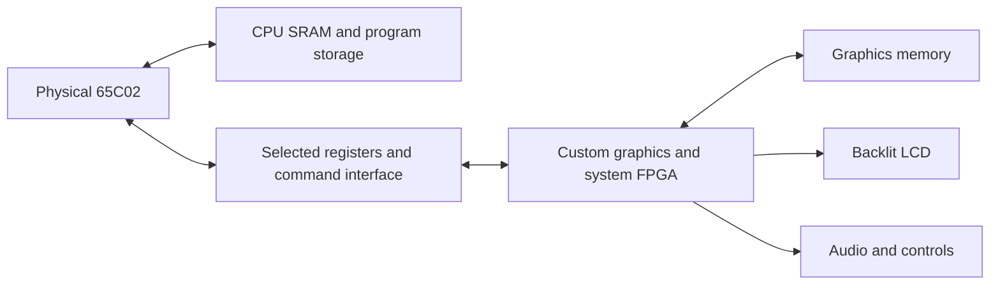

# Physical retro CPU with FPGA graphics

Current update, 2026-11-15: [ADR 0009](decisions/0009-tang-prototype.md) keeps the
CPU inside Tang Nano 20K for the first prototype. The ECP5 and physical-CPU
comparisons below are historical alternative research.

Date: 2026-10-30. Status: evaluated alternative, not selected for the first
standalone target under [ADR 0008](decisions/0008-standalone-development-target.md).
The [selected platform](standalone-platform.md) keeps the CPU in ECP5-12F because
the current CPU/FPGA subtotal and I/O budget favor integration. The owner explicitly
supports using existing retro chips alongside the FPGA where useful. No physical
CPU, FPGA, memory part, sound IC or board layout is selected by this proposal.

## Physical CPU partition evaluated

| Function | Implementation candidate | Reason |
| --- | --- | --- |
| Game CPU | Physical W65C02S | Preserves the CPU family and moves CPU logic outside the FPGA |
| CPU work memory | External parallel SRAM | Familiar bus interface; independent CPU storage can avoid competing with graphics draws |
| Program storage | Flash/ROM, with a defined boot/loading path | Resident code/assets without a host computer; serial flash needs a controller or loading into RAM |
| Scaling, layers, raster effects, triangles | Original FPGA HDL | Keeps the defining custom hardware programmable during development |
| Video memory | FPGA buffers plus external memory as required | Choose width, latency and capacity against measured graphics traffic |
| Audio, timers, input and interrupts | Initially FPGA HDL | Simple circuits; separate ICs must justify their added cost, pins and board area |
| Voltage adaptation and bus selection | Standard transceivers/decoders/latches where useful | Handle electrical and interface requirements explicitly |

The diagram describes a candidate partition, not a complete schematic. A discrete
sound chip or 65C22-style I/O device remains possible if its sound/interface is
wanted and it improves the full board. Neither is necessary just to move a small
amount of logic out of the FPGA. Extra graphics engines should stay original HDL;
adding an old video processor would constrain the effects we are trying to build.

## What the CPU split changes

Our existing HDL CPU mapped to 2,759 iCE40 LUT4s in the
[CPU sizing probe](../research/fpga-and-custom-silicon.md). A physical CPU removes
that particular logic from the FPGA, but requires a real bus interface and glue
logic. The net saving must be synthesized; it is not automatically all 2,759 LUTs.
The current simulated ROM and console still use the soft CPU and are unchanged.

The W65C02S datasheet specifies 14 MHz at 5 V and 8 MHz at 3.3 V. A physical
W65C02S therefore does not establish the earlier 20 MHz enhanced CPU target.
Choose clock, memory access timing and voltage translators together. Original
Lynx compatibility still needs CPU/peripheral behavior, timing and bus-arbitration
tests; buying a 65C02 does not supply Suzy or Mikey compatibility.

## Pin count and bus architecture

UP5K's SG48 package provides 39 user I/Os. A direct CPU interface alone can use
16 address pins, eight data pins, clock, read/write, reset and IRQ: 28 signals.
This leaves little room for a parallel LCD, external graphics RAM, audio, inputs
and configuration constraints. A lower LUT count does not imply physical fit.

Compare a selected register window with external address decode, address/data
latches, narrower interfaces or a device/package with more I/O. Each adds parts,
latency or implementation work. CPU work RAM and graphics RAM can be separate;
if shared, explicitly design ownership, CPU stalls, bus isolation and refresh or
access scheduling. Never allow CPU and graphics logic to drive a shared bus at
the same time. Slow CPU submission must not become the per-pixel drawing path.

## Selection criteria and next evidence

Compare the complete parts/assembly cost, power and board area of soft-CPU and
physical-CPU designs. The roughly US$10 target applies to FPGA selection, not a
proven total cost for the CPU, memory, power, LCD and board. A slightly more
expensive FPGA could reduce total cost by eliminating separate chips or glue.
Do not freeze a part until CPU/register interface, LCD and RAM have a realistic
pin allocation and the graphics design has measured timing and bandwidth.

Continue Nix-based simulation using the CPU model as a development stand-in.
A future external-bus adapter needs independently verified strobes, reset,
interrupts, read/write timing and any wait-state behavior. Native resolution
remains 320×204; unmodified Lynx games remain 160×102 with exact 2× pixel output.
Recompilation stays deferred.

## References

- [WDC W65C02S electrical specifications](https://www.wdc65xx.com/wdc/documentation/w65c02s.pdf)
- [Lattice UltraPlus resources and package I/O](https://www.latticesemi.com/Products/FPGAandCPLD/iCE40UltraPlus)
- [Current CPU and peripheral implementation](software-prototype.md)
- [Enhanced graphics proposal](graphics-effects.md)
- [FPGA pricing and CPU sizing evidence](../research/fpga-and-custom-silicon.md)
