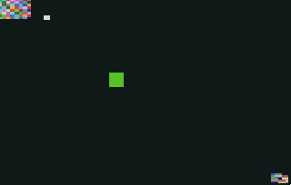

# Native graphics MMIO and CPU diagnostic

Reviewed: **2026-11-17**. Status: **experimental v1 implemented and tested with
the actual native CPU; complete enhanced console remains in development**.
This is a concrete development interface, not a frozen public SDK or the Lynx
compatibility map. The separate Circuit Courier machine retains its existing map.

## CPU work and autonomous graphics

[cb_blitter_mmio.sv](../../hardware/enhanced/cb_blitter_mmio.sv) connects an
eight-bit CPU-local register bus to the scaled blitter and a byte-access memory
client. Each CPU bus cycle completes locally. Software stages a descriptor,
submits it, and polls or takes an interrupt while the graphics domain works.
The CPU does not render pixels or wait for external memory on its instruction bus.

The [integration fixture](../../hardware/tests/native-graphics-top.sv) connects
the real pinned R65C02, 8 KiB local RAM and a 32 KiB original diagnostic ROM to
this interface. CPU RDY remains high; a general external-memory CPU stall/cache
adapter is still future work. The nominal test uses a 64 MHz graphics clock and
16 MHz CPU clock, with additional ratios/phases. Those are simulation clock
assumptions; neither CPU speed nor complete enhanced timing is qualified yet.

The [system chapter](../chip-design/system.md#cpu-driven-graphics-diagnostic)
shows the command/result mailbox diagram. CPU commands and results cross as
stable bundled data with synchronized request, response and acknowledgment
toggles. A submitted descriptor stays unchanged until the transaction finishes.
The returned result is captured as one CPU-domain record and held while software
reads its bytes. Physical synchronizer placement and bundled-data timing still
need a complete-board constraints/CDC review; these tests do not model metastability.

## Register map

Offsets below are relative to **$4400**. All reads are free of side effects,
including CPU dummy reads. Writes act once per CPU clock edge with a write
strobe. Unmapped reads return zero and unmapped writes do nothing.

| Offset | Read | Write |
| --- | --- | --- |
| `$00` | Device ID `$CB` | Ignored |
| `$01` | Interface revision `1` | Ignored |
| `$02` | Status, defined below | Ignored |
| `$03` | Zero | Control: submit, acknowledge result, clear rejection |
| `$04` | IRQ enable in bit 0 | Set IRQ enable from bit 0 |
| `$05` | Held result error, bits 2:0 | Ignored |
| `$06–$07` | Held 16-bit tag, little endian | Ignored |
| `$08–$0B` | Held 32-bit read data, little endian | Ignored |
| `$0C–$0F` | Command cycles | Ignored |
| `$10–$13` | Sampled pixels | Ignored |
| `$14–$17` | Written pixels | Ignored |
| `$18–$1B` | Read requests | Ignored |
| `$1C–$1F` | Write requests | Ignored |
| `$20–$23` | Memory stalls | Ignored |
| `$40–$63` | 36-byte staging descriptor | Edit staging bytes, including during execution |

| Status bit | Meaning |
| --- | --- |
| 0 | Available: no command in flight and no unacknowledged result |
| 1 | Busy: submitted command waiting for or executing in graphics domain |
| 2 | Done: a result is held for acknowledgment |
| 3 | Held result has a nonzero error; valid while Done |
| 4 | Sticky rejected submission |
| 5 | Synchronized hardware protocol fault |
| 6 | Synchronized SDRAM initialization complete |
| 7 | IRQ enable |

Control bits are **0: submit**, **1: acknowledge**, **2: clear rejection**.
Other bits are ignored. Submission copies all staging bytes atomically only if
Available. A busy/held-result submission sets Rejected without replacing the
accepted descriptor or its tag. A single acknowledge+submit write does not reuse
a held result: it acknowledges it and rejects that submission. Software uses
separate writes. A fresh rejection wins over a simultaneous clear-rejection bit.

IRQ is level-sensitive when enabled and any of Done, Rejected or Fault is set.
Acknowledgment clears Done; clear-rejection clears Rejected. Fault recovery
requires handling/resetting its source. New completion wins over a simultaneous
control write. Reads cannot acknowledge an interrupt accidentally.

Result fields retain their last values after acknowledgment, but Done determines
their validity. New results replace the entire record. Counters wrap at 32 bits.
Draw/fill cycle counters come from the blitter and exclude MMIO staging and CDC
latency. Byte-operation cycles measure graphics-side decode/issue/response work;
byte samples/pixels are zero and exactly one read or write request is reported.

## Descriptor encoding

All multi-byte fields are little endian. Canonical reserved bits must be zero;
bad encodings produce completion error **5** before memory access. Signed X/Y
use 12-bit two's complement with the upper four serialized bits zero, so `−3`
is encoded `$FD,$0F`. The source/destination rules below supplement the
[blitter component contract](../chip-design/sprites.md#experimental-component-contract-v1).

| Byte offset | Field |
| --- | --- |
| 0 | Bits 1:0 operation: 0 draw, 1 fill, 2 write byte, 3 read byte; bit 2 fill covered; bit 3 packed 4-bpp; bits 4/5 flip X/Y; bit 6 source-zero transparency; bit 7 zero |
| 1 | Fill palette index |
| 2 | Low nibble palette bank; high nibble insertion band |
| 3–4 | Caller tag |
| 5–7 | 23-bit source byte address; top serialized bit zero |
| 8–10 | 23-bit destination byte address; top serialized bit zero |
| 11–12 | 9-bit source width |
| 13–14 | 9-bit source height |
| 15–16 | Source stride in bytes |
| 17–18 | Destination stride in bytes |
| 19–20 | Signed 12-bit X |
| 21–22 | Signed 12-bit Y |
| 23–24 | 11-bit destination width |
| 25–26 | 11-bit destination height |
| 27–28 | 10-bit clip X0 |
| 29–30 | 10-bit clip Y0 |
| 31–32 | 10-bit clip X1 |
| 33–34 | 10-bit clip Y1 |
| 35 | Write-byte value |

Draw/fill retain the component's errors **1–4** for dimensions, stride/alignment,
physical extent and conservative overlap. Error zero includes valid empty clips.
For byte operations, flag bits 7:2 must be zero; only destination, tag and byte
data are used, and unused fields are ignored. Byte accesses select the correct
lane of an aligned x32 request. Read data returns the selected byte in bits 7:0,
with other bits zero. Write-byte and draw/fill return zero in the data field.

The port has **one outstanding command/result**, shared by draws and byte
accesses. Byte uploads cannot run concurrently with a draw through this port.
Software can edit the next staging descriptor while a draw runs, but there is
no command FIFO or resident 256-descriptor array. A later batch/upload interface
can improve submission cost without changing the existing pixel engine.

## Reset and ownership

Common reset must be asserted while both clocks run. It clears staging bytes,
mailbox toggles, busy/done/rejection/IRQ-enable state and protocol faults.
Joint controller reset cancels pending memory ownership. Issued physical writes
are not rolled back; the model retains committed data, while real memory
retention and board timing remain unqualified. Software must clear or discard a
partially written back surface before publishing it.

This component does not enforce front/back ownership or publish a display frame.
Callers still choose a surface not being displayed and immutable draw sources.
There is no automatic timeout/abort. Frame ownership, native palette/layers and
scanout are the next integration boundary.

## Independent acceptance

The strict-warning [register-driver test](../../sim/blitter-mmio.cpp) checks
**399 held results** across three clock ratios/phases: 159 draw/fill commands,
201 byte commands and 39 malformed descriptors. It covers staging changes after
submit, duplicate/combined control writes, status/IRQ, stable multi-byte results,
all byte lanes and bank edges, all component error codes, format errors without
memory access, early initialization submission and joint reset recovery.
The real blitter, elastic arbiter and SDRAM controller are connected throughout.
The unchanged independent SDRAM pin model and direct pixel reference check
complete physical storage, including unchanged guards.

The separate [CPU test](../../sim/native-graphics.cpp) boots the
[original ca65 ROM](../../firmware/enhanced-diagnostic.s) cold and warm at each
clock configuration: **six boots**, **654 accepted submissions**, **138,802 CPU
instruction fetches**, and **six IRQ completions acknowledged by the CPU handler**.
Each boot uploads 96 source bytes through CPU instructions, probes three byte
addresses, submits ten tagged draw/fill/validation cases and verifies error/tag
results itself. One intentionally rejected duplicate submit cannot replace a
clear. An independent observer checks the CPU's commands against separately
specified descriptors, then compares every stored word with the pixel reference.
The host performs **zero asset uploads** to the DUT.



This exact 320×204 image is decoded from modeled SDRAM after the actual CPU
diagnostic runs. A test palette makes covered index zero gray and cleared pixels
dark. It is not a native scanout capture or an implemented RGB palette/compositor.
All three clock configurations produce byte-identical output.

Separate synthesis of the MMIO plus blitter uses **2,281 registers**,
**2,562 LUT1–LUT4 cells** and **1,091 ALU cells**, plus mux primitives, without
DSP, block RAM or unintended latches. This excludes the CPU, ROM/RAM, memory
service, compositor and scanout; it is not a complete enhanced fit or timing result.

```sh
nix --extra-experimental-features 'nix-command flakes' build \
  .#blitter-mmio-check -o build/blitter-mmio-check -L
nix --extra-experimental-features 'nix-command flakes' build \
  .#native-graphics-check -o build/native-graphics-check -L
```

Artifacts include original ROM bytes/listing/map, exact source and CPU-source
snapshots, logs, JSON, mapped MMIO netlist and raw surface previews. The
[dated evidence](../research/evidence/native-graphics-2026-11-17.json) distinguishes
this CPU integration from the [renderer-only workload measurements](../milestones/scaled-blitter.md).
There is no shared boot monitor/launcher, complete enhanced board top, native
frame ownership, complete-system 60 fps result or physical enhanced run yet.
