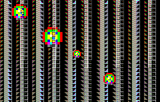

# Enhanced console skeleton

Last updated 2026-11-24. The enhanced top passes its system test in simulation
and places and routes for the Tang Nano 20K with the open tools. It has no
input, audio or loader, and nothing has run on a board. The
[system architecture](../architecture/overview.md) explains the design; this
page records what was built and what the results are.

## What exists

[cb_enhanced_system.sv](../../hardware/enhanced/system/cb_enhanced_system.sv)
connects the pinned R65C02, 8 KiB of RAM and a 32 KiB ROM in block RAM, the
[graphics command port](../architecture/native-graphics-mmio.md) with the scaled
blitter, video control, two tile planes, native scanout and the shared SDRAM
service. [cb_enhanced_tang_board.sv](../../hardware/enhanced/system/cb_enhanced_tang_board.sv)
adds the same clock, reset, pin and serializer blocks as the legacy bench top.

| Block | Role |
| --- | --- |
| [cb_native_scanout.sv](../../hardware/enhanced/cb_native_scanout.sv) | Reads the front 320 × 204 surface, merges the tile planes, and shows the result through a 256-entry RGB444 palette at exact 2×, centered in 640 × 480. Derived from our legacy scanout: same mailbox crossing and alternating line buffers |
| [cb_tile_planes.sv](../../hardware/enhanced/cb_tile_planes.sv) | Two scrolling 64 × 32 tile maps and 256 shared 8 × 8 patterns in block RAM. See [tile planes](../chip-design/compositor.md) |
| [cb_video_control.sv](../../hardware/enhanced/cb_video_control.sv) | CPU registers at `$4500`: enable, swap and plane latch, frame counter, palette port, plane scroll, tile memory port, underrun and ownership-fault status |
| [enhanced-demo.s](../../firmware/enhanced-demo.s) | ROM that loads the palette, tiles and maps, uploads a sprite, then each frame clears, draws four scaled sprites, scrolls both planes and swaps |

Scanout is the third client of the one memory service, beside the blitter and
the CPU byte port. It has no priority; round-robin service has been enough for
this light scene and nothing more is claimed.

## Frame ownership

Two surfaces sit at `$100000` and `$140000`. The displayed one belongs to
scanout. The CPU draws into the other and requests a swap; the swap is taken
only at the scanout's frame boundary, before any row of the next frame is
fetched, and the surface is then held for all 204 rows. Plane scroll and
enables ride on the same request, so they change on the same frame as the
sprites. `FRONT` and the pending bits change together in the CPU's view.

A graphics write into the displayed surface, or into either surface while a
swap is pending, sets a sticky ownership fault the CPU can read. The write
still happens. A row that is not ready in time is shown black as a whole pair
of output lines and counted as an underrun.

## Clocks

The CPU and its local memory use one real 8 MHz clock, made by a divider
primitive from the 64 MHz system clock. Block RAM offers only rising-edge
clocks, so RAM, ROM, palette and tile memory writes use the rising edge and
every CPU-domain register uses the falling edge of the same net. CPU `RDY`
stays high and is unvalidated. A first attempt that read memory on a
logic-inverted clock routed with hold violations; the mapping check now rejects
any clock pin driven by logic.

Graphics and video are treated as unrelated to the CPU clock and cross through
toggle synchronizers. One known gap: the command port's CPU-side registers
still take the graphics-domain reset directly. CPU writes are gated by the
separately synchronized CPU reset, but that release path has not been reviewed.

## Results

The [test](../../sim/enhanced-system.cpp) supplies clocks and the SDRAM pin
model and draws nothing itself. It captures complete 640 × 480 frames and
requires each to be exactly one frame of a separately written reference
sequence: the previous frame again or the next one, never a mixture.

- 14 distinct frames, no repeats and no torn frames, across two clock
  configurations (25.2 MHz pixel clock with an 8 MHz CPU; a slower pixel clock
  with a 10.67 MHz CPU).
- Every pixel matches: sprites, both planes with flips, palette banks and
  scroll wrap, and sprite bands on both sides of the front plane.
- Exact 2× replication, black bars, 800 × 525 vertical period, no underrun and
  no ownership or protocol fault.
- A second ROM that deliberately draws into the displayed surface raises the
  fault, and the CPU reports it.
- Seven faults injected into the plane and priority logic were each caught.



The picture is a test card, not art. Each tile, flip and palette bank appears
somewhere so that a wrong one changes pixels. It is the reference rendering of
the last frame the test matched against the captured output.

| Resource on GW2AR-18 | Sprites only | With tile planes | Available |
| --- | --- | --- | --- |
| LUT4 sites | 7,885 | 8,396 | 20,736 |
| Registers | 2,906 | 3,239 | 15,552 |
| Block RAM | 21 | 29 | 46 |

| Clock | Target | Open-tool estimate |
| --- | --- | --- |
| System / SDRAM | 64 MHz | 74.67 MHz |
| CPU and local memory | 8 MHz | 22.13 MHz |
| Pixel | 25.2 MHz | 73.27 MHz |

Adding the planes first broke the system clock: 63.96 MHz on the first route
and 61.47 MHz on the second. The slow path was not in the new logic. It was in
the blitter's sampling step, which in one cycle recomputed the flipped source
column, added it to the row address, compared the sum with the cache tag and
then decided what to do with the write buffer. The source column and the sample
address are now registers that step with the destination pixel, so sampling
compares the tag against a register. The blitter's pixel results and cycle
counts are unchanged. This is one seed; the estimate has moved by several
megahertz between placements of nearly the same design, so read the margin
with that in mind.

These are frequency estimates from tools with no serializer or I/O timing
model and no cross-domain analysis, the same limits as the
[legacy board build](tang-board-build.md). No bitstream is packaged.

```sh
nix --extra-experimental-features 'nix-command flakes' build \
  .#enhanced-system-check -o build/enhanced-system-check -L
nix --extra-experimental-features 'nix-command flakes' build \
  .#enhanced-board-check -o build/enhanced-board-check -L
```

The [dated evidence](../research/evidence/enhanced-system-2026-11-24.json) records
the results and source hashes.

## What this does not show

The scene is four small sprites over two planes. Holding 60 frames per second
here says nothing about the [dense renderer workloads](scaled-blitter.md) once
they share the bus with scanout. Next: input and audio on this top, then
Circuit Courier or a comparable game, and measure the combined load and the
scanout deadline with it.
