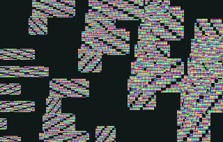

# Scaled-blitter component acceptance

Reviewed: **2026-11-17**. Status: **component and real-controller model checks
pass; complete enhanced-system acceptance remains open**. This is original
project RTL. It has no imported Suzy, VERA or other graphics-engine implementation.
The source cache, exact sampler, clipping, write combiner and completion
control are circuits; software models are test oracles.

## Implemented scope

[cb_scaled_blitter.sv](../../hardware/enhanced/cb_scaled_blitter.sv) draws packed
4-bit or 8-bit sources into a **320×204** indexed object surface. It supports
independent scaling/flips, signed origins, user clipping, optional source-zero
transparency, palette banks, insertion bands, rectangle fill and transparent
clear. The [v1 component contract](../chip-design/sprites.md#experimental-component-contract-v1)
defines the fields, validation errors, memory protocol and reset limitations.

An explicit coverage bit distinguishes an empty pixel from an opaque pixel using
index zero. A surface word contains zero in bits 15:13, coverage in bit 12,
insertion band in 11:8 and the palette index in 7:0. This remains experimental
component data, not a frozen CPU-visible command ABI.

The exact sampler uses integer remainders. Unity scaling and enlargement carry
in the sampling/store cycle; minification retains repeated subtraction. Cached
samples enter the write combiner directly, and a sample waiting behind an older
word resumes on that word's ACK. Fill emits one or two pixels per aligned word,
with masks on partial edges, without walking each pixel through the sampler.
The source cache and write combiner each hold one 32-bit word. A completion waits for every
write ACK and remains stable until accepted. No CPU pixel loop, multiplier,
divider, destination read or host GPU performs the production draw operation.

## Independent functional evidence

The [direct integer reference](../../sim/scaled-blitter-model.hpp) uses division
for each destination sample, independently of RTL stepping. The
[component test](../../sim/scaled-blitter.cpp) checks **513 commands**,
**2,208,062 logical samples** and **2,022,893 written pixels**. It compares the
complete modeled memory, including bytes that must remain unchanged.

Coverage includes both source formats, all flips, fractional ratios, extreme
minification, source/destination limits, unaligned sources, odd packed rows,
padding, transparent and opaque index zero, coverage/clear semantics, invalid
commands, source changes between commands and descriptor-input changes after
acceptance. Arbitrary ready/response delays exercise request stability and the
final fence. Held completion cannot change its tag, status or counters.
Reset cancels outstanding work; an unexpected response sets the sticky fault.
The optimization adds 96 paired-fill cases covering both destination halfword
alignments, alternating row alignment, narrow/right/bottom edges and covered or
clear writes. Another 24 cases straddle the single-carry scaling threshold in
both formats and every flip combination. A full aligned fill must emit exactly
32,640 writes, with no source reads.

The [integration fixture](../../hardware/tests/enhanced-blitter-memory-top.sv)
connects the engine to the enhanced elastic round-robin arbiter and actual
auto-precharge x32 SDRAM controller. The [memory-service acceptance](enhanced-memory.md)
records their implementation and tests; the legacy system now shares them.
Its [test](../../sim/scaled-blitter-memory.cpp) uses the independent
physical-command [memory model](../../sim/sdram-model.hpp), uploads assets through
the memory interface, and compares physical storage with the pixel reference.
It checks **1,521 completed commands**, **1,376,448 written pixels**,
**837,036 accepted engine transactions**, **837,033 completions** and **three
reset cancellations**. It observes **18,133 refreshes**, with a maximum gap of
**512 system cycles** under contention.

Reset cases include a write held behind controller backpressure, a write already
committed to SDRAM before its completion token, and a physical read still in
flight. Committed data survives logic reset. Fresh clear/draw commands after
memory reinitialization must complete without old tokens or requests.

## Measured workloads, including missed budgets

These are cycle measurements at an **assumed 64 MHz**. The enhanced configuration
has not been routed or clock-qualified. Synthetic front reads request one
32-bit word every 32 cycles, approximately **8 MB/s** of payload. They are not a
native scanout implementation. The maximum observed response from a scheduled
release is **25 cycles** in this fixture.

| Scene, including clear | Original baseline | Optimized blitter on legacy service | Current cycles | Current time at assumed 64 MHz | Within 16.667 ms? |
| --- | --- | --- | --- | --- | --- |
| 64 small sprites | 12.167 ms | 8.761 ms | 358,851 | 5.607 ms | Yes, renderer/memory only |
| 256 small sprites | 22.531 ms | 16.406 ms | 701,452 | 10.960 ms | Yes, renderer/memory only |
| 32 scaled sprites plus continuous host traffic | 23.656 ms | 22.617 ms | 932,576 | 14.572 ms | Yes, renderer/memory only |

The [original failed-budget baseline](../research/evidence/scaled-blitter-baseline-2026-11-17.json)
and [optimized-blitter/legacy-service baseline](../research/evidence/scaled-blitter-legacy-memory-2026-11-17.json)
are retained. All three scenes preserve their original commands, sampled/written
pixel counts and engine read/write request counts. The enhanced service reduces
the dense scene by another **33.2%** and the host-contended scene by **35.6%**
relative to the optimized blitter on legacy memory. All three 64 MHz renderer
budgets are checked regression limits. Dense and host-contended scenes also
repeat with front-read releases offset by 1, 7, 15 and 31 cycles. The slowest
scaled repeat takes **932,591 cycles / 14.572 ms**, leaving approximately
**2.095 ms** in a 60 Hz frame before adding other system work.

Small sprites are 16×16 with alternating packed/byte sources, transparency,
flips, palette banks and insertion bands. The 256-draw scene samples 130,816
pixels including clear, writes 117,504 pixels, performs 15,360 reads and 62,336
writes, and spends 406,844 cycles waiting on memory. The scaled scene includes
clipping and competing host read/write requests.

Memory-stall counters can rise while total cycles fall: a faster producer asks
for memory earlier and spends a larger share of its shorter command in an
outstanding request. Compare total elapsed cycles under the same offered
traffic, as well as requests and stalls. Continuous host traffic remains enabled
throughout the third workload; no host throttling was added to obtain a pass.

These measurements exclude CPU command marshaling, the many-plane compositor,
actual native scanout and game logic. A passing renderer workload does not
establish a complete 60 fps game. Full-system throughput remains open: add the
CPU, layer and real native scanout costs before choosing a simultaneous-scene
contract. Preserve the original failures as history and retain the same workload
limits as the integrated system grows.

## Inspect the written object surface



This 320×204 diagnostic preview is decoded from the model's actual SDRAM storage
after the RTL writes and ACKs. A test palette visualizes its indices. It is not
an implemented palette/compositor, CPU-driven game, video scanout capture or
physical screen photograph. The scene exercises clipping, enlargement,
minification, flips, transparency and overlap.

## Mapped resource scope

The standalone component maps to **887 registers**, **1,366 LUT1–LUT4 cells** and
**1,018 ALU cells**, plus mux primitives. The baseline used 885 registers, 991
LUT1–LUT4 cells and 817 ALUs: the faster paths cost logic. It uses **no DSP, block RAM or unintended
latches**. These are pre-route cell counts, not a physical logic-site sum or a
reservation in the earlier legacy board build. There is no enhanced-system
place/route or timing result yet.

## Reproduce

```sh
nix --extra-experimental-features 'nix-command flakes' build \
  .#scaled-blitter-check -o build/scaled-blitter-check -L
nix --extra-experimental-features 'nix-command flakes' build \
  .#scaled-blitter-memory-check -o build/scaled-blitter-memory-check -L
```

Recipes are in [nix/enhanced.nix](../../nix/enhanced.nix). Artifacts contain exact
source snapshots, tool versions, compilation/test logs, JSON and the object
surface preview. The [dated evidence](../research/evidence/scaled-blitter-2026-11-17.json)
records source/media hashes and keeps functional pass distinct from performance
and integration qualification.

## What remains

The separate [native MMIO/CPU diagnostic](../architecture/native-graphics-mmio.md)
now passes. Add batch command storage, front/back ownership, palette/composition, native scanout and explicit
frame deadlines. Optimize the dense and contended workloads, measure the full
system with CPU/compositor traffic, and synthesize/route that configuration.
Stretch/tilt, affine rotation, collision behavior and alpha blending remain
separate extensions. No fabricated custom die or physical enhanced console is
established by this milestone.
