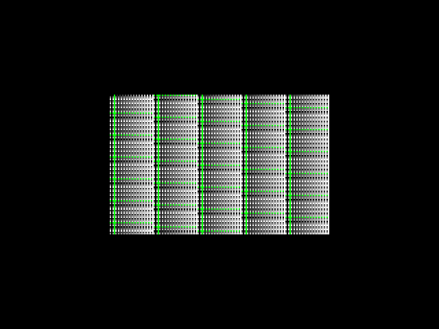

# Buffered Lynx video acceptance

Date: **2026-11-17**. Status: **parallel RGB/timing verified in software**.
The portable system now connects the actual Lynx core to capture, shared SDRAM,
cross-clock line buffering and exact 2× output. HDMI serialization, real board
clock/reset/pin constraints, physical output and audio transport remain open.

## What now works together

The pinned CPU/Suzy/Mikey implementation emits 160×102 RGB444 samples. Original
project RTL captures those colors immediately, writes three presentation banks
in SDRAM, publishes only completed frames, and reads the selected frame through
two alternating line buffers. A separate pixel clock produces a centered
320×204 image on a 640×480 transport. Each source pixel becomes exactly four
output pixels; all borders and blanking are black.

The transport uses 800×525 total positions, active 640×480, negative horizontal
sync at X 656–751 and negative vertical sync at Y 490–491. At the intended
25.2 MHz pixel clock this is 60 Hz. The canvas begins at (160,138). This is the
initial exact-2× bench mapping; the final panel and any additional integer
physical scaling remain separate decisions.



The preview comes from simulated output RGB samples of the original diagnostic,
not from a host renderer implementing the console. Gray levels vary by source
index; index 1 turns green/red with the A button.

## Reproduce

```sh
nix --extra-experimental-features 'nix-command flakes' build .#video-pipeline-check -o build/video-pipeline-check -L
nix --extra-experimental-features 'nix-command flakes' build .#lynx-tang-video-check -o build/lynx-tang-video-check -L
nix --extra-experimental-features 'nix-command flakes' build .#tang-system-sizing -o build/tang-system-sizing -L
```

Artifacts retain compile/test logs, evidence, source links and tool versions.
The real-core check also exports observed green/red PNG and PPM previews. The
[dated evidence snapshot](../research/evidence/tang-video-2026-11-17.json)
records exact artifacts and source hashes. These tests need no attached board,
Atari BIOS or commercial game.

## Independent component checks

The [component fixture](../../hardware/tests/tang-video-top.sv) uses the real
capture, arbiter, SDRAM controller and scanout. Its
[testbench](../../sim/video-pipeline.cpp) generates spatial RGB patterns and
compares every 65,280-pixel canvas. An unrelated client continuously writes and
reads its own memory region while capture and display contend for service.

| Requirement | Evidence |
| --- | --- |
| Exact 2× and stable frame | Every output pixel compared with one known complete source frame; repeat and replacement exercised |
| Timing and borders | Every coordinate, DE, sync width/polarity, border and blanking sample checked |
| Memory ownership | No writes to the displayed bank; no display reads from an unowned bank; stable requests during stalls |
| Contention and refresh | 1,277,166 competing-client completions; maximum modeled refresh gap 509 clocks |
| Late line data | Deliberately withheld memory produces five missed row-pair deadlines; every affected pair stays wholly black, then correct pixels recover |
| Capture overflow | One intentionally overflowing source frame is invalidated and never presented; the previous complete frame survives |
| Joint reset | Reset with a real outstanding request; one host transaction explicitly cancelled; old ownership/fault state does not survive |
| Clock crossing | Nominal 64/25.2 MHz ratio and a second pixel rate, with noncoincident edge phases |

The clock scheduler uses system half-period 126 time units, pixel half-period
320 or 318, and an odd pixel phase. The second case is a stress test, not a
different accepted video mode. Digital simulation does not model metastability;
the crossing structure and eventual constraints still require board-level review.

## Real console, real serial loading

The second check uploads an original 218-byte BS93 image over the actual
460800-baud UART and CRC protocol. The CPU verifies local RAM, arithmetic and
cartridge bytes before enabling display. Its packed 4-bpp image varies across
rows and columns, and all palette entries are initialized explicitly.

The run checks cold boot, A held, A released and stop/reupload/warm boot.
After warm boot it changes A again and verifies both colors, proving that a
retained old green frame cannot satisfy reload acceptance. It
observes **19 complete output canvases**, including the changed palette and
whole-frame repeats, across **28,427,386 master clocks**. Each output canvas is
compared against an actual complete emitted console frame, including legitimate
palette changes during capture. All four copies of every source sample agree.
There are **12 cartridge requests and acknowledgments**, **two external cartridge
reads** through the cache, and **56,688 refreshes**. No unintended capture,
ownership or underrun fault is reported.

## Ownership and reset contract

The [line reader](../../hardware/video/lynx_scanout.sv) takes one coherent line,
buffer and frame request at a time. Metadata stays stable until an acknowledged
toggle crosses back. Each toggle has a two-register synchronizer. A completed
line owns its buffer until both output copies are consumed. Row N+2 cannot
refill row N's bank sooner. Readiness is latched before the pair begins; a late
acknowledgment cannot reveal half a row.

Frame-bank handoff happens in vertical blank only after the prior reader has
finished. Source/display cadence can differ: capture replaces an older completed
candidate, while scanout repeats the existing complete frame if none is ready.
Stopping a game preserves the last displayed complete frame while capture drains
its unfinished candidate. A later committed image replaces it normally.

Both clock-domain resets must assert together. Each must release synchronously
to its own clock in the eventual board wrapper. Independent unilateral resets
are not supported by this mailbox. Hard reset flushes queued transactions and
ownership; memory contents themselves need not be erased.

## Mapping and remaining boundary

The two line buffers map into **one Gowin block RAM**. The integrated portable
system, including the console, UART/loader/cart services, capture, arbiter,
SDRAM controller and RGB scanout, maps into **35 block RAMs** with no unintended
latches. This includes the console's local work RAM and the capture queue.

This is a synthesis result, not full-board placement/routing or timing closure.
The earlier registered core-only route result remains a separate configuration.
The complete board still needs clock generation, reset synchronizers, pin/I/O
buffers, output serialization, audio transport and reviewed timing constraints.
No commercial games or physical Tang runs have been tested. Enhanced graphics
fit and throughput are not established by this legacy-path work.

The later [stereo audiovisual acceptance](tang-audio.md) adds actual Mikey tones,
signed filtering and pin-decoded I²S while retaining this video-only regression.

See the [scanout diagram](../chip-design/legacy.md#buffered-output-and-clock-crossing),
[earlier service acceptance](tang-board-services.md) and
[work plan](../roadmap.md).
